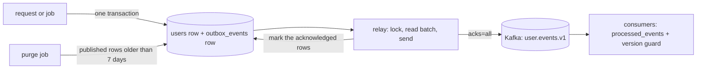
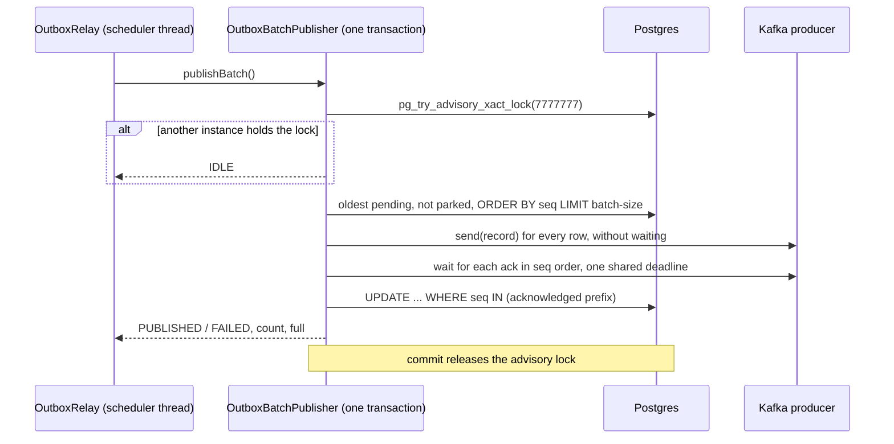

# Transactional outbox and relay

How a service changes its own database and tells the rest of the system about it without ever losing the announcement or announcing something that did not happen. The code is in `services/user-service` (`outbox/` is the writer, `outbox/relay/` the reader); every service that produces events will use the same shape. This document is the design the code is built to, including the paths that were tried and dropped.

## 1. The problem and the guarantee

A service that writes to its database and then publishes to Kafka has two writes and no transaction spanning both. Commit and then crash: the event is lost. Publish and then crash (or roll back): an event announces a change that never happened.

The outbox makes the event part of the same database transaction as the change. A separate relay then moves committed rows to Kafka. The relay can crash between "Kafka acknowledged" and "row marked published", so it may send a row twice. The guarantee is therefore:

- **At-least-once.** An event may arrive late, twice or slightly out of order; it never fails to arrive.
- **Per-aggregate ordering of state changes**, with the caveats in section 8.
- **Consumers are idempotent** (`02-processed-events-design.md`).



## 2. The table

`outbox_events` (migrations V7 and V8). One row is one complete event.

| Column | Purpose |
|---|---|
| `seq` | `bigint` identity, primary key. `ORDER BY seq` is the publish order. A timestamp can tie and a UUID has no order. Identity values are assigned at insert time, which matters for ordering (section 8). |
| `id` | The event id (`uuid`, unique). Generated in the envelope, so a re-publish carries the same id and consumers can deduplicate on it. |
| `aggregate_type`, `aggregate_id` | `User` and the user id as text. `aggregate_id` is the Kafka key: one aggregate's events share a partition. `text`, not `uuid`, so an aggregate with another id type still fits. |
| `aggregate_version` | The entity's `version` after the change (nullable). Consumers use it to reject stale events. It has gaps: a version bump that emits nothing leaves one, so consumers compare with `>`, never `previous + 1`. Null for an event that is not "state of one aggregate" (a participant's confirmation about a user, for example). |
| `event_type`, `schema_version` | Consumer dispatch; the payload shape's version (check `>= 1`). |
| `topic` | Where to publish. Stored so the relay is generic and needs no mapping from type to topic; today it is always `user.events.v1`. |
| `payload` | `jsonb`, must be a JSON object, under 256 KB (`chk_outbox_events_payload_is_object`, `chk_outbox_events_payload_size`). The **entire** event: envelope fields and `data`. See below. |
| `correlation_id`, `causation_id` | The trace or request that started the chain, and the event that caused this one. Both nullable; `correlation_id` is always null until tracing is added (`docs/open/03-roadmap.md`), and the relay forwards it as a header when it is set. |
| `occurred_at` | Domain time; also inside the payload. |
| `created_at` | Row insert time (database default). `published_at - created_at` is the outbox latency, and the age of the oldest pending row's `created_at` is the stall alarm. |
| `published_at` | Null means pending; anything else means done. |
| `attempts`, `last_error` | Diagnostics for a send that failed (`attempts >= 0`). |
| `parked` | Operator quarantine (V8): the relay skips parked rows, and a parked row is unpublished by definition (`chk_outbox_events_parked_unpublished`). Nothing parks a row automatically (section 9). |

**The payload is the whole event** because the value on Kafka must not depend on how it got there. If the envelope lived in separate columns, switching to change-data-capture (section 14) would change the value's shape and every consumer with it. With the full body in `payload` the consumer sees byte-identical values from either publisher.

**No `status` column.** `published_at IS NULL` is the state; there are exactly two, and a nullable timestamp also says when. An enum invites a `PROCESSING` state that needs lease-expiry logic, which the advisory lock (section 6) makes unnecessary. No `headers` column (the headers derive from the columns) and no `partition` column (the producer derives it from the key; storing it would pin the partition count into data).

**Indexes**, both partial so they stay small however many published rows pile up: `idx_outbox_events_pending (seq) WHERE published_at IS NULL AND NOT parked` (the relay's hot query, which must repeat the same condition for Postgres to use it), `idx_outbox_events_published (published_at) WHERE published_at IS NOT NULL` (the purge job and replay by range), and `idx_outbox_events_parked (seq) WHERE parked` (the parked gauge and un-parking).

Rows are never updated by business code: the relay updates `published_at`, `attempts` and `last_error`, and the purge job deletes.

## 3. Writing an event

`OutboxService` has one method per event type (`recordUserRegistered`, `recordUserUpdated`, `recordUserDeletionScheduled`, `...Cancelled`, `...Started`, `...Finalized`). The rules (also in `docs/open/04-conventions.md`):

- **`@Transactional(propagation = MANDATORY)`.** The method must join the business transaction; with no transaction open, Spring throws. An event can never be written on its own, and a rollback of the change rolls the event back with it.
- **Only the request that changed the row emits.** The caller checks the native query's row count (or the entity's version before and after `saveAndFlush`). A repeated request that changes nothing writes nothing.
- **Build the event from the row as the database now holds it** (re-read after a native update), and take `occurredAt` from the row's database-stamped time (`created_at`, `updated_at`, `deletion_requested_at`, `deletion_started_at`, `deleted_at`). The database owns time and the version.
- **One envelope, generated once.** The event id is created in the `EventEnvelope`, the payload is that envelope as JSON, and every column is read from that same object, so the row and the payload cannot disagree.
- **A plain `save()`.** The identity key makes Hibernate run the `INSERT` immediately, so a violation (a duplicate event id, an oversized payload) fails inside the caller's transaction and rolls the change back with it.

Poison rows are prevented here instead of handled later: the topic is a constant, the serializer is `StringSerializer`, and the payload size is checked by the database.

## 4. The event body

What `payload` holds, and what a consumer receives as the record value:

```json
{
  "eventId": "7c2d9e14-5a60-4b8f-9d31-e4f5a6b7c8d9",
  "eventType": "UserUpdated",
  "schemaVersion": 1,
  "aggregateType": "User",
  "aggregateId": "6f9619ff-8b86-4d11-b42d-00c04fc964ff",
  "aggregateVersion": 3,
  "occurredAt": "2026-02-01T00:00:05Z",
  "correlationId": null,
  "causationId": null,
  "producer": "user-service",
  "data": { "email": "leon.kennedy@example.com", "displayName": "Leon Kennedy", "timezone": "Europe/Istanbul" }
}
```

Kafka headers: `event_id`, `event_type`, `schema_version`, and `correlation_id` when present. Field-level rules, the fixtures and schema versioning: `docs/open/06-kafka-event-contract.md`.

## 5. The relay: who does what

Two beans, so a transaction is never started by a call from the same class:

- **`OutboxRelay`** decides *when*. It is the `@Scheduled(fixedDelay = interval)` bean and is not transactional. Per tick it runs up to `max-batches-per-tick` batches and keeps going only while a batch came back full and fully acknowledged, so a backlog after an outage drains in one tick instead of fifty-row slices two seconds apart. It also owns the backoff (section 10) and the two counters.
- **`OutboxBatchPublisher.publishBatch()`** decides *what*. It is `@Transactional` and returns a `RelayBatchResult` (`IDLE`, `PUBLISHED`, `FAILED` or `INTERRUPTED`, the number published, whether the batch was full, and the failure).

(An earlier relay called its own transactional method through `this.`, which bypassed the proxy: `published_at` was never persisted. The split is what prevents that.)

## 6. One batch



1. **Single active relay.** `pg_try_advisory_xact_lock` is a database-level mutex held for the transaction. Every instance runs the schedule; only one gets the lock and the others return `IDLE`. If the holder dies, Postgres releases the lock when its connection closes. This is leader election with no extra infrastructure, and it is what keeps two relays from interleaving one aggregate's events.
2. **Oldest first.** The batch is the oldest unpublished, unparked rows in `seq` order.
3. **Phase 1, send everything.** `kafkaTemplate.send` appends each record to the producer's buffer and returns at once; a separate sender thread ships ready batches, typically the whole loop in one or two requests. Records for one partition keep their order (idempotent producer). If `send` itself throws (no topic metadata within `max.block.ms`), nothing after that row is sent: it would only be left unpublished and sent again behind that row anyway.
4. **Phase 2, collect the acknowledgements in `seq` order** against one deadline for the whole batch (`send-timeout-ms`). Only an acknowledged row may be marked published. The first failure (the producer's own timeout, `RecordTooLargeException`, or the relay's deadline) records `attempts + 1` and `last_error` on that row, logs one WARN with the row's `seq` and event id, and stops.
5. **Mark the acknowledged prefix** with a single `UPDATE ... WHERE seq IN (...)` (`published_at = CURRENT_TIMESTAMP`, `attempts + 1`). A database error here propagates and rolls the transaction back; it is not counted as a failed send.
6. **Commit** releases the lock.

An interrupt (shutdown) restores the interrupt flag and returns `INTERRUPTED` without counting an attempt: it says nothing about the row.

Spring wraps every producer error (`KafkaProducerException "Failed to send"`, or `KafkaException "Send failed"` when `send` throws). `rootCause` strips only those wrappers, so `last_error`, the log and the result carry the real exception.

### Why send in a pipeline

The first design sent one record, waited for its ack, marked it, and moved on: simple and strictly ordered, but one network round trip per row. The pipelined batch costs about one round trip per batch with the same delivery guarantee (mark only after the ack, mark only the acknowledged prefix, everything inside the locked transaction). The price is ordering: "stop at the first failure" now stops *marking*, not *sending*. Rows after a failed one are already with the producer and may reach the log before it, so a consumer can see an aggregate's newer event before its older one. The tail still converges, because every delivered-but-unmarked row is inside the next window and is resent after the failed row, which is why consumers must apply the version guard to state projections. Completing the futures with `whenComplete` callbacks was rejected: they run on the producer's network thread after the transaction has committed and the advisory lock is gone.

## 7. Producer settings

All in `application.yaml` under `spring.kafka.producer`, each with a comment, including those equal to the client's defaults, so nothing important is implicit.

- `acks=all`, `enable.idempotence=true`, `retries` at its maximum (bounded by the delivery timeout), `max.in.flight.requests.per.connection=5` (safe with idempotence), `compression.type=none`, `linger.ms=5`.
- **Time limits drive the relay's failure behaviour.** `delivery.timeout.ms=5000` equals the relay's `send-timeout-ms`, so records the relay abandoned die in the producer at about the same moment instead of living for the default 120 s (and turning into surprise duplicates). `request.timeout.ms=3000`. `max.block.ms=1500` is short because only a failing tick ever waits for metadata.
- **The producer's own backoff is what protects Kafka**: `retry.backoff.ms=100` up to 1000, `reconnect.backoff.ms=50` up to 1000. The relay adds no retry loop of its own against Kafka.
- **These settings are shared by the service's two producers**: the relay's, `relayKafkaTemplate` over `relayProducerFactory` (both in `KafkaProducerConfig`; the template is the one `OutboxBatchPublisher` gets), and the consumer's dead-letter publisher. Each has a client id of its own (`app.kafka.relay-producer.client-id` and `app.kafka.dead-letter-producer.client-id`; the shared settings carry none), so the two producers have separate identities in metrics and in the broker's logs (`02-processed-events-design.md`, section 4).
- **`KafkaProducerConfig` replaces Boot's `LoggingProducerListener` with a silent one, for every producer of the service.** The default logs every failed record's key *and payload* at ERROR (an email and a display name) with a stack trace, up to 50 times per failed tick. This was found by `RelayIT`. The relay reports a failure once, with ids only: the WARN, `last_error` and the counter.

## 8. Ordering and duplicates

- **Per aggregate.** The key is `aggregate_id`, so all events for one user land on one partition in the order the relay sent them, which is `seq` order. For state changes of the same row, `seq` order is commit order: a second transaction on the same row waits for the first's row lock, so it inserts its outbox row, and gets its `seq`, only after the first has committed. Across different aggregates nothing is ordered and nothing needs to be.
- **The one hole in any polling outbox.** `seq` is assigned at insert, not at commit, so a transaction that inserted `seq 40` and commits after `seq 41` has been read can become visible late and be published after 41. The business transaction is short (the outbox insert is its last statement), and as above this can only reorder two *different* aggregates' events.
- **Duplicates** come from a crash between the ack and the mark, a batch that failed part-way (the delivered tail is resent), and a producer record that outlived an abandoned tick. All carry the same `id`, key and payload.
- **What consumers do:** deduplicate on `event_id` and reject stale state with `aggregateVersion >`, and treat lifecycle events (`UserDeletionStarted`) as terminal (`02-processed-events-design.md`).

## 9. Failure policy: stall and alert, never skip

A common alternative is to park a row after N failed attempts so it stops blocking the queue. It was rejected, because parking turns a delay into a loss. A parked `UserUpdated` carrying an email change would leave notification-service mailing the old address forever (user-service's own row already holds the new one and nothing would re-announce it); a parked deletion event would leave an account stuck. The rule instead:

> An outbox event may arrive late, twice or slightly out of order, never not at all.

Every send failure stops the batch at the failed row. Earlier rows are marked, the failed row gets `attempts + 1` and `last_error`, later rows stay pending and are resent. A misconfiguration (a topic ACL, say) stalls delivery and raises the age alarm; fixing it drains the backlog in order. The `parked` column and the `NOT parked` filter exist for a manual operator quarantine (planned with the replay endpoint, section 16); nothing parks a row automatically.

## 10. Backoff instead of a circuit breaker

The first relay wrapped its send in a Resilience4j circuit breaker (window 5, 100 % failures, 30 s open, a half-open probe). It was replaced by a plain consecutive-failure backoff, because a breaker did not fit what the relay is:

- The relay *pulls* from Postgres with one scheduler thread. A dead Kafka cannot make threads pile up, and the outbox table is itself the buffer that absorbs the outage. A breaker protects a service that *pushes* requests from many threads.
- Kafka is not at risk either: the producer already backs off reconnects and retries, and the relay sends at most one batch per tick.
- What a failing tick does cost is the relay's own resources: a database connection and the advisory lock for up to `send-timeout-ms`, an `UPDATE` of `attempts`/`last_error`, and a WARN, every ~7 seconds for as long as the outage or a poison row lasts.
- The breaker also opened only after five such ticks (about 35 s), counted partial progress as a failure, idled a fixed 30 s however short the outage, sent a full 50-record batch as its "probe", and its open-state gauge flapped to 0 during each probe, so an alert on "open for long" could never fire.

The replacement: a tick that publishes **nothing** (`FAILED` with zero rows) makes the relay skip the following ticks for `backoff.initial-ms` (4000), doubling per consecutive failed tick up to `backoff.max-ms` (30000). Any tick that publishes a row, including a failed batch that got some rows out, resets it at once (Kafka works, the failed row is now the head of the queue; if it keeps failing, the next tick publishes nothing and the backoff starts). `IDLE`, `INTERRUPTED` and database errors neither count nor reset: a database error says nothing about Kafka, and a longer wait would only slow the recovery from a database blip. It reaches Spring's scheduler, which logs it at ERROR and keeps the schedule. A poison row at the head of the queue is throttled by the same mechanism, with no exception classification. The backoff clock is injectable, so tests move time without sleeping.

Resilience4j stays in the project where it fits: the Keycloak admin client is request-and-response with waiting threads (`03-account-deletion-saga.md`, section 9).

## 11. Metrics and alerts

`OutboxMetrics` (a `MeterBinder`) reads live values on every scrape; `OutboxRelay` owns the counters.

| Meter | Meaning |
|---|---|
| `outbox.pending.rows` | unpublished, unparked rows |
| `outbox.oldest.pending.age.seconds` | age of the head of the queue by `seq` (not `min(created_at)`), 0 when empty; the stall alarm; `NaN` while the database is down |
| `outbox.parked.rows` | rows set aside by an operator |
| `outbox.relay.consecutive.failed.ticks` | 0 = healthy; N = the last N ticks published nothing. A plain count that only returns to 0 on progress, so "above 0 for 2 minutes" is a safe rule (a breaker-state gauge would flap) |
| `outbox.rows.published` (counter) | rows acknowledged and marked |
| `outbox.batches.failed` (counter) | batches that stopped on a send error |

The two counters deliberately have different names and units: the rows behind a failed one are neither published nor failed, and a failure that hits a whole partition counts once, so a failure "rate" is not computed by dividing one by the other.

Alert rules to add when something scrapes them: oldest pending age above 60 s for 2 min (warn) and above 300 s (critical), `outbox.parked.rows` above 0, `outbox.relay.consecutive.failed.ticks` above 0 for 2 min (warn). The Prometheus endpoint is part of the observability step.

## 12. Purge and replay window

`OutboxPurgeJob` (`app.outbox.purge.cron`, daily at 03:00) deletes published rows older than `retention-days` (7) in batches of 1000, oldest first, until a batch comes back short, and logs one summary line. Seven days is the replay window: within it, resetting `published_at` for a range of `seq` (or one aggregate) re-emits events. Beyond it, a consumer rebuilds from the topic (retention must cover it) or from a snapshot event (planned, section 16). Replaying is safe because consumers deduplicate by `id` and reject stale versions.

## 13. Known gaps and accepted trade-offs

Deferred on purpose; pick them up with the step named, or when a load test or an incident asks for them.

- **No database timeouts** (`statement_timeout`, `lock_timeout`, `idle_in_transaction_session_timeout`, JDBC `socketTimeout`, `tcpKeepAlive`): a hung session can hold the advisory lock (every other instance then gets `IDLE` forever, silently) and a hung JDBC call blocks the scheduler thread. Part of the observability step.
- **No topic validation.** `outbox_events.topic` has no format check, and a wrong or missing topic stalls the relay on that row forever (a missing topic shows up as metadata timeouts, which look transient). Fix: a check in a new migration (`^[A-Za-z0-9._-]{1,249}$`) and optionally a startup check that the topic exists.
- **A few duplicates around an outage are still possible.** With `delivery.timeout.ms` equal to the relay's deadline, abandoned producer records die about when the tick does, but not exactly. `RelayIT` measured it: after a broker pause the relay's own deadline fires before the producer's expiry, and from the second failed tick the producer has lost its metadata, so `send` throws after one `max.block.ms` wait.
- **A cold producer with Kafka down costs one `max.block.ms` wait per tick**, not one per row: a metadata timeout makes `send` throw and phase 1 stops at the first throw. A warm producer accepts the sends and the tick ends on its own 5 s deadline instead.
- **Database failures are not counted as failed ticks** (above); they fail loudly through the scheduler's ERROR log. Optionally, catch `DataAccessException` and log one WARN without the stack trace.
- **Alerts are not wired** until something scrapes the gauges.
- **Accepted trade-offs.** The transaction, and with it the advisory lock, stays open while the relay waits for acks (5 to 10 s worst case; a session-level leader lock with short transactions would avoid it). Each instance keeps its own backoff state, and the backoff sits before the lock, so while the leader waits another instance may take the lock and attempt: the cluster-wide retry rate is N times the single-instance one, still a few records per ~30 s, and a failover starts with no backoff. There is one global `seq` order, so one unavailable partition would hold everyone's events (not possible with one broker). The scheduler pool is 6 threads so a slow relay tick never delays the other jobs (`docs/open/02-user-service-status.md`).

## 14. Later: change-data-capture

The table is shaped so a Debezium outbox router could replace the polling relay without any consumer noticing: `id`, `aggregate_id` (key), `event_type`, `payload` (verbatim value) and `topic` map onto the router's fields, and `schema_version` and `correlation_id` can travel as headers. Switching would mean stopping the scheduled relay (a property), enabling the connector, and deleting each outbox row right after inserting it in the same transaction (Debezium sees the insert in the write-ahead log; the delete keeps the table empty). `published_at`, `attempts` and `last_error` become unused. Nothing here depends on it; it is recorded because it is why the payload holds the whole event.

## 15. Configuration and tests

`app.outbox.relay.*`: `interval-ms` 2000, `batch-size` 50, `send-timeout-ms` 5000, `max-batches-per-tick` 10, `backoff.initial-ms` 4000, `backoff.max-ms` 30000. `app.outbox.purge.*`: `retention-days` 7, `batch-size` 1000, `cron` `0 0 3 * * *`. The advisory lock key is `7_777_777`. The intervals are kept small while the relay is proven; they are to be settled with load tests.

Tests:

- Writer: `OutboxServiceTest` (Mockito, plain `JsonMapper`: row columns and payload come from one envelope, the right timestamp per event, a fresh event id per call, the deletion events carry no email or name), `OutboxServiceIT` (Boot's real `ObjectMapper`: `MANDATORY` throws without a transaction; each `record*` writes one row whose `occurred_at` equals the user's database timestamp and the payload's `occurredAt`), `UserEventContractTest` (payload against the fixture files).
- Schema: `OutboxEventSchemaIT` (every constraint, the index definitions), `OutboxRepositoryIT` (batch query skips published and parked rows and keeps `seq` order; the gauge counts; `oldestPendingAgeSeconds` measures the head of the queue and skips parked and published rows; `markPublished` and `recordError`; the purge's strict retention boundary, oldest first, batch limit).
- Relay: `OutboxBatchPublisherTest` (Mockito: lock, idle, success, `full`, record content, every failure shape including a failure in the middle of a batch, interrupt, database error), `OutboxRelayTest` (drain loop, `max-batches-per-tick`, backoff delays 4, 8, 16, 30, 30 s with a fake clock, a failure after progress is not a stalled tick, IDLE/INTERRUPTED/database error leave the state alone, counters), `OutboxPurgeJobTest`, `OutboxPurgeJobIT`, `OutboxMetricsTest`, `RelayIT` (Testcontainers Postgres and Kafka, a slim context without the scheduler so the test decides when a tick happens, the broker "taken down" with `docker pause`: record key, headers, payload and partition order; a 120-row backlog drained in one tick; a second instance holding the lock; a paused broker leaves nothing marked, the real cause in `last_error`, recovery, no payload in the logs; a cold producer waits once per tick; the backoff delays a failed tick and a skipped tick touches nothing), `RelaySchedulingIT` (real beans and properties, Spring's own scheduler firing the relay; starting the context proves the `app.outbox.*` properties bind and the cron parses).
- Not covered on purpose: the Prometheus endpoint (observability step), a commit failure after a Kafka ack, per-batch commits of the purge job.

## 16. Roadmap

- Replay: the `UserSnapshot` event with its fixture, `POST /api/v1/admin/users/replay-snapshots`, outbox replay by aggregate id or `seq` range, and the operator quarantine that uses `parked` (`docs/open/03-roadmap.md`, replay step).
- Topic format check and database timeouts (section 13).
- Prometheus endpoint, alert rules, trace id into `correlation_id` (observability step).
- Relay tuning with load tests.
- Outbox for the other services as they are rebuilt: the same table shape, writer rules and relay.
