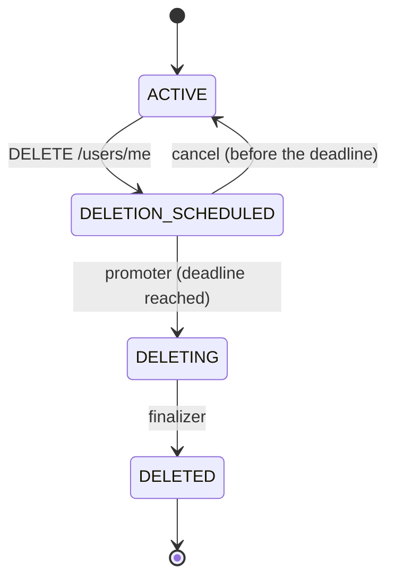
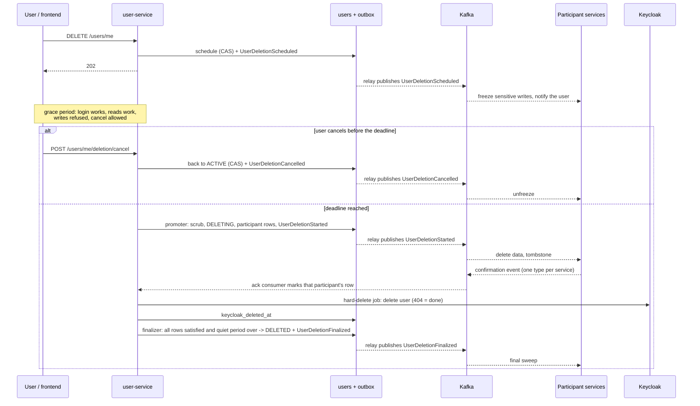

# Account-deletion saga

How user-service deletes an account, and how the other services follow. This is the design the code is built to, and it is kept in step with the code and the plan: when either changes, this document changes in the same change (section 17 holds the roadmap and what is done). It replaces the earlier "delete immediately, irreversible" plan and builds on `01-outbox-design.md` (the transactional outbox) and `02-processed-events-design.md` (consumer deduplication).

## 1. Goals and non-goals

**Goals**

- A user can delete their account and can change their mind for a configurable grace period.
- When the grace period ends, their personal data disappears from every service, and from Keycloak, without anyone having to run anything by hand.
- No step can be lost: a service being down, Kafka being down, Keycloak being down or an instance crashing mid-step delays the deletion but never skips or corrupts it, and every delay is visible.
- The design works with several instances of user-service and with services that are added later.

**Non-goals**

- Deleting from backups or from Kafka before their retention expires (see section 13).
- Legal advice: the grace length and the claim "erased" are product and legal decisions (section 13).
- Building the email-change feature: section 10 records its agreed design because it interacts with the deletion state, but it is a separate, later feature and the saga does not depend on it.

## 2. Principles

1. **The database commits first.** Every state change is one local transaction that also writes the outbox event. Anything outside the database (Kafka, Keycloak, other services) happens after a commit and is retried until it succeeds.
2. **Compare-and-set transitions.** Every status change is an `UPDATE ... WHERE status = '<expected>'` that reports the rows it changed. Two requests racing for the same transition: one wins, the other sees zero rows.
3. **The database owns time.** Deadlines are absolute timestamps computed by Postgres (`CURRENT_TIMESTAMP + grace`), and every comparison uses the database clock. Changing configuration later never moves a deadline that was already set.
4. **At-least-once everywhere, idempotent handlers.** An event may arrive late, twice or slightly out of order, never not at all. Consumers deduplicate with `processed_events` and compare `aggregateVersion` with `>`.
5. **Stall and alert, never skip.** A step that cannot complete leaves the row where it is and raises a metric. Nothing is forced through, because skipping a step silently is how data stays behind.
6. **Keycloak does not know our states.** Keycloak is the identity provider (login, registration, passwords, MFA, tokens). It is never asked to enforce deletion rules; user-service is the only place where "this account is being deleted" is a fact, and it enforces it itself.
7. **Fix what a deletion promises when it starts.** The deadline is stored as an absolute time, the set of services that must confirm is stored per deletion, and configuration changes only affect deletions that start afterwards.

## 3. Actors

| Actor | Role in the saga |
|---|---|
| user-service | Owns the account, the state machine, the jobs and the events. The only service that talks to Keycloak's admin API. |
| Keycloak | Authenticates users. Its user is hard-deleted by user-service after the grace period. Never holds deletion state. |
| Participant services (device-, alert-, notification-, usage-, ai-insight-service, ...) | Each deletes the data it holds for the user on `UserDeletionStarted`, confirms with an event, and sweeps again on `UserDeletionFinalized`. They may also freeze sensitive writes while a deletion is scheduled. |
| Kafka (`user.events.v1`, one topic per participant for its confirmations) | Carries the events. Key = user id, so one user's events are ordered. |
| Frontend | Reads `status` / `deletionScheduledFor` from `GET /users/me`, shows the Cancel button. It enforces nothing: every rule is also enforced by the backend, because clients other than the frontend can call it. |

## 4. State machine



| Status | Meaning | What the user can do |
|---|---|---|
| `ACTIVE` | Normal account. | Everything. |
| `DELETION_SCHEDULED` | The user asked to be deleted; `deletion_scheduled_for` is when it becomes irreversible. Nothing has been deleted anywhere. | Log in, read everything, cancel. Sensitive writes are refused (409). |
| `DELETING` | Irreversible. Email and name are scrubbed, participants are cleaning up, the Keycloak user is being (or has been) deleted. | Nothing: 410 on every endpoint. |
| `DELETED` | Every required participant confirmed (or was waived) and the quiet period passed. The row stays as a scrubbed tombstone. | Nothing: 410. |

There is no way back from `DELETING`. The only undo is cancelling while the account is still `DELETION_SCHEDULED`.

## 5. Schema (migrations V11–V14 on top of V1–V10)

Four migrations, one concern each: `V11__users_add_deletion_schedule_and_scheduled_status` (new columns, backfill, status and consistency checks, indexes), `V12__users_allow_keycloak_deleted_at_while_deleting`, `V13__create_user_deletion_participants_table`, `V14__users_drop_keycloak_disabled_at_and_devices_deleted`. They are applied.

`users` (changes):

- Status check gains `DELETION_SCHEDULED`.
- `deletion_requested_at` (existing): when the user asked. Set when scheduled, cleared on cancel.
- `deletion_scheduled_for` (new, `timestamptz`): the deadline. Set with the request, cleared on cancel, kept afterwards as history.
- `deletion_started_at` (new): when the promoter moved the row to `DELETING`. It is the `occurredAt` of `UserDeletionStarted` (the generic `updated_at` moves on any later update, so it cannot serve).
- `keycloak_deleted_at` (existing): when Keycloak confirmed the hard delete; now allowed on `DELETING` as well as `DELETED`.
- Dropped: `keycloak_disabled_at` (the account is no longer disabled in Keycloak at any point; it is deleted) and `devices_deleted` (replaced by the participants table).
- Constraints tie each timestamp to the statuses that imply it, so an impossible state cannot be stored:
  - `(status = 'ACTIVE') = (deletion_scheduled_for IS NULL)`
  - `(status = 'ACTIVE') = (deletion_requested_at IS NULL)`
  - `(status IN ('DELETING','DELETED')) = (deletion_started_at IS NOT NULL)`
  - `(status = 'DELETED') = (deleted_at IS NOT NULL)` (existing)
  - `keycloak_deleted_at IS NULL OR status IN ('DELETING','DELETED')`
  - `deletion_scheduled_for >= deletion_requested_at` (equal means "delete now", used by admin-initiated deletion)
- Indexes: `idx_users_deletion_scheduled (deletion_scheduled_for) WHERE status = 'DELETION_SCHEDULED'` (the promoter's scan) and `idx_users_deleting (deletion_started_at) WHERE status = 'DELETING'` (finalizer, Keycloak job, watchdog), both partial so they stay small whatever the number of accounts. The old `idx_users_deleting` on `deletion_requested_at` is replaced.
- Backfill before the constraints go on: a row already in `DELETING` or `DELETED` gets `deletion_scheduled_for` and `deletion_started_at` equal to its `deletion_requested_at` (an immediate deletion; the `DELETED` rows need the value too, because the started-at rule covers them).

`user_deletion_participants` (new):

```sql
CREATE TABLE user_deletion_participants (
    user_id     uuid        NOT NULL REFERENCES users (id),
    participant text        NOT NULL,
    acked_at    timestamptz,
    waived_at   timestamptz,
    PRIMARY KEY (user_id, participant)
);
```

One row per service that must confirm *this* deletion, written by the promoter in the same transaction that sets `DELETING`. A row is satisfied when `acked_at` or `waived_at` is set. See section 8.

`uq_users_email` (existing, partial on `status <> 'DELETED'`) is unchanged: the promoter scrubs the email to `deleted+<id>@invalid`, which is unique per id, so a scrubbed row never blocks a real address.

## 6. HTTP contract (user-service)

Problem types live under `https://home-energy-tracker/problems/`.

| Request | `ACTIVE` | `DELETION_SCHEDULED` | `DELETING` / `DELETED` |
|---|---|---|---|
| `GET /api/v1/users/me` | 200, `status: ACTIVE`, `deletionScheduledFor: null` | 200, `status: DELETION_SCHEDULED`, `deletionScheduledFor` | 410 `account-deleted` |
| `PATCH /api/v1/users/me` (and any future write) | 200 | 409 `deletion-scheduled` | 410 |
| `DELETE /api/v1/users/me` | 202; schedules; emits `UserDeletionScheduled` | 202, same date, no event (idempotent) | 410 |
| `POST /api/v1/users/me/deletion/cancel` | 204, no-op | 204; back to `ACTIVE`; emits `UserDeletionCancelled`. If the deadline has passed but the promoter has not run yet: 409 `deletion-deadline-passed` | 410 |

Provisioning (the interceptor in front of `/api/v1/users/**`) lets `ACTIVE` and `DELETION_SCHEDULED` through and answers 410 for `DELETING` and `DELETED`; the write rules above are enforced in the service layer, in the same transaction that changes the row, because a request can pass the interceptor and then lose a race with a schedule.

Statements that are one transaction each:

```sql
-- schedule
UPDATE users SET status = 'DELETION_SCHEDULED',
       deletion_requested_at = CURRENT_TIMESTAMP,
       deletion_scheduled_for = CURRENT_TIMESTAMP + :grace,
       version = version + 1
 WHERE id = :id AND status = 'ACTIVE';

-- cancel
UPDATE users SET status = 'ACTIVE',
       deletion_requested_at = NULL, deletion_scheduled_for = NULL,
       version = version + 1
 WHERE id = :id AND status = 'DELETION_SCHEDULED'
   AND deletion_scheduled_for > CURRENT_TIMESTAMP;
```

After a zero-row result the code re-reads the row to tell "already in the target state" (idempotent success) from "too late" (409 / 410). `GET /users/me` and the 202 of `DELETE` carry the same account representation (`status`, `deletionScheduledFor`), so the frontend can show the date straight away; the schedule's own zero-row case that finds the row `ACTIVE` again (someone scheduled and cancelled in between) is answered 409 `concurrent-modification`, because neither "scheduled" nor "not scheduled" would be true. The user's identity always comes from the token's `sub`; a user can never name another user (an admin acts on `{id}` through admin endpoints only).

## 7. Events

All on `user.events.v1`, key = user id, envelope as for the existing user events, each with a contract fixture in the `contracts` module. `aggregateVersion` has gaps by design; consumers use `>`.

| Event | `data` | `occurredAt` from | Consumers do |
|---|---|---|---|
| `UserDeletionScheduled` | `deletionScheduledFor` | `deletion_requested_at` | Freeze sensitive writes for the user (flag, version-guarded); notification-service tells the user, with a cancel link. |
| `UserDeletionCancelled` | empty | `updated_at` | Unfreeze. |
| `UserDeletionStarted` | empty | `deletion_started_at` | Delete everything held for the user, reject new writes for them (tombstone, wins over any older event), then confirm (section 8). Irreversible. |
| `UserDeletionFinalized` | empty | `deleted_at` | Sweep again: delete anything created by a request that was already in flight when the tombstone landed. |

`UserDeletionStarted` does not carry the set of participants; services react to it regardless of who else takes part, so adding or removing a service never changes their code. Emitting follows the outbox rules: only the request or job that changed the row emits, the event is built from the row as the database now holds it, and the outbox row is written in the same transaction.

Earlier plans named the first of these `UserDeletionRequested`; it was renamed `UserDeletionStarted` because the account is no longer deleted at the request but at the end of the grace period.

## 8. Orchestration

### 8.1 Timeline of a deletion



### 8.2 Grace period

Login is untouched: Keycloak still authenticates the user, who needs to log in to cancel. The account is readable (profile, devices, readings, AI questions) and sensitive writes are refused. user-service refuses its own (`PATCH` → 409); every other service freezes its own sensitive writes from a per-user flag fed by `UserDeletionScheduled` / `UserDeletionCancelled`. Which writes are sensitive is each service's decision; device claiming is the clearest case (it creates new ownership). There is deliberately no central lock: a freeze that lags the event by a moment is acceptable, and `UserDeletionStarted` is the hard stop.

Password and MFA changes stay available in Keycloak (a compromised account has to be recoverable during the grace period). Changing the email is not available at all (section 10).

### 8.3 Promotion

The promoter turns an overdue `DELETION_SCHEDULED` row into `DELETING`, one account per transaction: scrub the email (`deleted+<id>@invalid`) and display name (`Deleted user`), `status = 'DELETING'`, `deletion_started_at = CURRENT_TIMESTAMP`, `version + 1`, one `user_deletion_participants` row for each service in the configured required set, and the `UserDeletionStarted` outbox row. It makes no external call, so it cannot half-fail.

```sql
-- the work list: a plain read, locks nothing
SELECT id FROM users
 WHERE status = 'DELETION_SCHEDULED' AND deletion_scheduled_for <= CURRENT_TIMESTAMP
 ORDER BY deletion_scheduled_for, id
 LIMIT :batch;

-- then, for each id, in a transaction of its own: the claim
UPDATE users SET status = 'DELETING', email = 'deleted+' || id || '@invalid', display_name = 'Deleted user',
                 deletion_started_at = CURRENT_TIMESTAMP, version = version + 1
 WHERE id = :id AND status = 'DELETION_SCHEDULED' AND deletion_scheduled_for <= CURRENT_TIMESTAMP;
-- 0 rows: someone else changed the row first; skip it. 1 row: insert the participant rows, write the event.
```

Each account has its own transaction, and the compare-and-set `UPDATE` is the claim (an earlier version of this design took a whole batch under `FOR UPDATE SKIP LOCKED` in one transaction). The reason is failure isolation: the oldest account is always first in the work list, so one account that cannot be promoted would fail the batch's single transaction on every tick and starve all the others. With a transaction per account the failure is logged (user id and the root cause's class, never the message, which a database error can fill with the row's contents), counted in `user.deletion.promotion.failures`, and the loop continues. The row lock the `UPDATE` takes does what `SKIP LOCKED` did for exclusion: a second promoter (or a cancel) working on the same account waits for the first to commit and then matches nothing. Two promoters walking the same list therefore serialise on the row locks instead of splitting it; that is harmless, and the wasted work is bounded by the batch size.

The names in `app.user.deletion.required-participants` are checked when the service starts (the table's name rule, no duplicates): a name the table would reject would otherwise fail every promotion, always on the first row of the list.

Cancel and promote exclude each other through the row lock and the status check: whichever commits first wins and the other sees zero rows. The time comparison only decides who may *start*; being late by one transaction's duration is harmless.

### 8.4 Keycloak hard delete

After the promotion commit, a job works through the `DELETING` accounts with `keycloak_deleted_at IS NULL`, oldest first, a small batch per tick:

```sql
-- the work list: a plain read, locks nothing
SELECT id FROM users
 WHERE status = 'DELETING' AND keycloak_deleted_at IS NULL
 ORDER BY deletion_started_at, id
 LIMIT :batch;

-- for each id: call Keycloak (DELETE /admin/realms/{realm}/users/{id}; no database involved), then one statement
UPDATE users SET keycloak_deleted_at = CURRENT_TIMESTAMP, version = version + 1
 WHERE id = :id AND status = 'DELETING' AND keycloak_deleted_at IS NULL;
```

**No database transaction is open during the Keycloak call.** The first version of this design took the rows with `FOR UPDATE SKIP LOCKED` and held the transaction (a connection and the row locks) across each HTTP call, bounded by a small batch and short timeouts. That ties the database to Keycloak's speed for no gain, because nothing here needs the lock:

- The delete is idempotent: a 404 (already gone) counts as success, so repeating it is always safe.
- A crash between the call and the `UPDATE` leaves the user deleted in Keycloak and the row unstamped; the next tick calls again, gets 404, and stamps.
- Two instances walking the same list both call Keycloak for the same account (harmless) and both run the `UPDATE`; the compare-and-set lets one stamp and tells the other it matched nothing. The cost is that duplicated work, bounded by the batch size.
- Failures (a timeout, a 5xx, an open circuit) leave the row as it is. A tick ends at the first call the open circuit breaker refuses, because the rest would be refused too; any other failure is counted and logged and the loop moves on to the next account.

The stamp is only ever written after Keycloak has confirmed (204 or 404), never before: the finalizer trusts it to mean "this account can no longer log in".


Keycloak is hard-deleted at promotion rather than disabled: from that moment the user cannot log in or refresh, and the email is free in Keycloak. Access tokens issued earlier stay valid until they expire (5 minutes), which is why the finalizer waits (8.6) and why user-service answers 410 from its own database regardless of the token.

### 8.5 Participants and the completion contract

When a deletion starts, the promoter writes one `user_deletion_participants` row per service in `app.user.deletion.required-participants`. That set is the completion contract *for this deletion*:

- A participant confirms with its own event type on its own topic (for example `UserDevicesUnclaimed` on `device.events.v1`; one event type per producer, its data and a fixture in `contracts`). The meaning is: "I no longer hold anything personal for this user, and I reject new writes for them." What that covers is the participant's own business and is named by its event: device-service releases every device the user had claimed (the device records stay, unowned, so they can be claimed again), removes the user's personal data about them, revokes their credentials and refuses new claims for the user. A service confirms even when it found nothing. The confirmation carries the id of the `UserDeletionStarted` it answers as `causationId`.
- The consumer is `ParticipantAckListener` (package `deletion.ack`), which reads the participants' topics with the group `user-service`, one record at a time. For a record it recognises (the topic and event type are in the registry, the schema version is the one it knows, the aggregate id is a user id) `ParticipantAckService` runs, in one transaction, the `processed_events` claim and `UPDATE user_deletion_participants SET acked_at = CURRENT_TIMESTAMP WHERE user_id = :id AND participant = :p AND acked_at IS NULL AND waived_at IS NULL`. Zero rows means "not required for this deletion, already confirmed, or waived": ignored and counted (the claim is kept, so the same event is not examined again); `waived_at IS NULL` is there because a waived row that also got an `acked_at` would break the table's acked-or-waived check and fail every retry. The `users` row is not touched, so the ack never conflicts with another update and never bumps the version. A claim and an update that fail together roll back together, and two copies of one event delivered at the same moment are applied once: the second waits for the first's claim and then finds it.
- A record the consumer can never apply (not JSON, no valid event id, a schema version it does not know, an aggregate id that is not a user id) goes to `device.events.v1.dlt` at once, unchanged, with the reason in the headers and without retrying; an event type it does not know on a participant's topic is ignored (a producer must be able to add types). A database failure is retried for as long as it lasts and never dead-lettered. `docs/design/02-processed-events-design.md` has the container's rules.
- Changing the configured set changes **future** deletions only. A deletion already in flight keeps the set it started with.
- Adding a participant later: new deletions include it; a deletion already in flight can be given its row by a migration plus a re-emitted `UserDeletionStarted` (the participant's cleanup is idempotent).
- Retiring a participant for good: an explicit, versioned migration sets `waived_at` on its unconfirmed rows. `waived_at` is separate from `acked_at` so an audit can tell a real confirmation from a waiver.
- **Adding a participant** to user-service is one entry in `ParticipantAcksConfig` (name, topic, event type, schema version): the listener subscribes to the topic by itself, the gauge for its pending confirmations appears, and the name becomes valid in the required set. The topic and its dead-letter topic go in `infra/kafka/kafka-topics.sh`.
- At startup the configured names are checked against that registry (`RequiredParticipantsValidator`); a typo fails the boot instead of silently stalling every deletion. The name's format and duplicates are checked by the promoter's service.
- While the set is empty (no participant service exists yet) the saga completes by time alone. The default configuration is empty; with `devices` required, a deletion waits for device-service.

### 8.6 Finalization

The finalizer (`DeletionFinalizationJob` driving `DeletionFinalizationService`) closes a deletion when both conditions hold: the Keycloak user has been deleted for the whole quiet period, and every participant row of this deletion is confirmed or waived. Like the promoter it reads a plain work list and then finalizes each account in a transaction of its own, with the compare-and-set as the claim:

```sql
-- the work list: a plain read, locks nothing
SELECT u.id FROM users u
 WHERE u.status = 'DELETING'
   AND u.keycloak_deleted_at <= CURRENT_TIMESTAMP - :quiet
   AND NOT EXISTS (SELECT 1 FROM user_deletion_participants p
                    WHERE p.user_id = u.id AND p.acked_at IS NULL AND p.waived_at IS NULL)
 ORDER BY u.keycloak_deleted_at, u.id
 LIMIT :batch;

-- then, for each id, in a transaction of its own: the claim
UPDATE users SET status = 'DELETED', deleted_at = CURRENT_TIMESTAMP, version = version + 1
 WHERE id = :id AND status = 'DELETING'
   AND keycloak_deleted_at <= CURRENT_TIMESTAMP - :quiet
   AND NOT EXISTS (SELECT 1 FROM user_deletion_participants p
                    WHERE p.user_id = users.id AND p.acked_at IS NULL AND p.waived_at IS NULL);
-- 0 rows: someone else finalized it first, or a condition no longer holds; skip it. 1 row: write the event.
```

A match becomes `DELETED` with a `UserDeletionFinalized` outbox row, built from the row as the database now holds it (`occurredAt` is its `deleted_at`). The design first took a batch with `FOR UPDATE SKIP LOCKED`, and was changed to per-account transactions for the promoter's reason: an account that cannot be finalized would fail the single transaction of the batch on every tick, and being first in line it would starve all the others. The `UPDATE` repeats every condition of the work list, because the list may be stale when its row is reached: two finalizers serialise on the row lock, and the one that waited re-evaluates its `WHERE` against the committed row and matches nothing. The participant subquery can only be stale in one safe direction: a confirmation that commits during the statement is not seen yet, so the account is finalized a tick later, never too early (nothing turns a confirmed row back into a pending one, and rows are written only at promotion).

The quiet period (`app.user.deletion.quiet-period`, 10 minutes in production, zero allowed, negative refused at start) is measured from the Keycloak delete: no new token can be issued after it, and any token issued before it expires within 5 minutes, so after the quiet period nothing can still be acting for the user. It does not start before Keycloak has confirmed: with Keycloak failing, or before the confirmation, an account stays `DELETING` however old it is. `UserDeletionFinalized` then asks every service for a last sweep, which catches resources created by a request that passed its checks just before that service processed `UserDeletionStarted`.

A required participant that never confirms stalls finalization for that user, and `user.deletion.participant.pending.acks{participant}` names it. It is never forced: a stuck `DELETING` row harms nobody (the user is already gone from Keycloak and scrubbed), whereas forcing it would hide incomplete deletions. A failing account is logged (user id and the root cause's class, never the message), counted in `user.deletion.finalization.failures`, and the loop moves on.

### 8.7 Observability

The promoter has two counters: `user.deletion.promoted` (accounts this instance moved to `DELETING`) and `user.deletion.promotion.failures` (promotions that threw; a rate above zero means an account is stuck). The finalizer has `user.deletion.finalized` and `user.deletion.finalization.failures`, and the ack consumer counts `user.deletion.participant.acks` by participant and outcome (`acked`, `already_processed`, `not_pending`). The Keycloak job has `user.deletion.keycloak.deleted` and `user.deletion.keycloak.failures` (a failure rate above zero means Keycloak, or the rights of the service account, are in trouble) and the admin client has the gauge `keycloak.admin.circuit.state` (0 closed, 1 half open, 2 open; alert on 2 for more than a minute). The orphan-address handling (8.8) counts `user.email.orphan.released` and `user.email.collision.live` (the second should stay at zero: it means Keycloak and our rows disagree about an address). The watchdog gauges, read live like the outbox metrics: `user.deletion.scheduled.accounts` (accounts in the grace period), `user.deletion.deleting.oldest.age.seconds` (the longest-running deletion, 0 when none), `user.deletion.keycloak.oldest.pending.age.seconds` (how long the longest-waiting `DELETING` account has been without its Keycloak user deleted), `user.deletion.participant.pending.acks{participant}` (deletions still waiting for that participant) and `keycloak.admin.circuit.state`; plus the counter for token-vs-row email mismatches (section 10). Alert rules arrive with the Prometheus endpoint. Dead-letter topics of every consumer need their own alert, because a poison `UserDeletionStarted` in a participant's dead-letter topic is the one failure that would otherwise be silent until the stall alert fires.

### 8.8 Orphan email collision

A row that outlived its Keycloak user (an operator deleted the user in Keycloak's console; nothing told us) still holds its address in `uq_users_email`. When the same person registers again Keycloak accepts it, because the address is free there, and issues a new `sub`; but the new account cannot be provisioned, because its address belongs to the old row.

What happens, in `ensureUsable` (the provisioning step of every customer request):

1. **The insert is refused by the address, and says so without failing.** The provisioning insert is `INSERT ... ON CONFLICT DO NOTHING` (no conflict target, so it covers the primary key and the address index alike). It returns 0 in both cases and the caller reads the row back: a row with the new id exists = a concurrent request created it (carry on, as before); no row = the address belongs to another account. An exception would also tell them apart, but it would abort the transaction, and the next step needs to go on from here.
2. **The transaction is rolled back and the Keycloak part happens after it.** `ensureUsable` is not `@Transactional` itself: its database work runs in a transaction opened with a `TransactionOperations`, so the question to Keycloak (below) is asked with no transaction open, like the hard-delete job.
3. **Who holds the address?** `findLiveByEmail`: the one non-`DELETED` row whose lower-cased address matches (a `DELETING` row has been scrubbed and holds nothing). None any more (it was released meanwhile) = answer 503 `email-being-released`, the retry will work.
4. **Does that account still exist in Keycloak?** `userExists(holder id)`.
   - **No**: the holder is an orphan. It goes through the ordinary saga with a grace period of zero (`scheduleForImmediateDeletion`): an `ACTIVE` account is scheduled with the deadline set to now and announced with `UserDeletionScheduled` like any other schedule; an account that is already scheduled further out gets its deadline moved to now (no new event: the schedule was announced, and consumers act on `UserDeletionStarted`, not on the date). The promoter scrubs the address on its next tick, after which the retry is provisioned. The new request is answered **503 `email-being-released`** with `Retry-After: 10`.
   - **Yes**: Keycloak and our row disagree about whose address this is (it was probably changed in Keycloak's console). Nothing is changed and the answer is **409 `email-already-in-use`**, with an ERROR in the log naming the holder's id and the counter `user.email.collision.live`; only an operator can resolve it.
   - **Keycloak cannot answer** (down, slow, circuit open): **503 `identity-provider-unavailable`** with `Retry-After: 30`, and nothing is changed. A dead Keycloak must never make every colliding account look like an orphan.

The address is never handed to the new `sub` directly. That would mean deciding in the middle of a request that one person's data may be replaced by another's; the old account instead goes through the normal deletion path, with its events and its participants' cleanup.

The orphan's own Keycloak delete (the hard-delete job, 8.4) then finds nothing to delete and gets 404, which counts as success.

## 9. Keycloak

- **Client for user-service** (built in step 5f, package `keycloak`): a confidential service-account client holding only `manage-users` and `view-users` from `realm-management`; its secret comes from the environment variable `USER_SERVICE_ADMIN_CLIENT_SECRET` (the application does not start without it). The interface `KeycloakAdmin` has two idempotent operations, `deleteUser(id)` (204 and 404 both mean success) and `userExists(id)`; everything else that can happen is one `KeycloakUnavailableException` (a subclass when the circuit refused the call), so callers never need to tell causes apart. The implementation uses `RestClient` over the JDK HTTP client (HTTP/1.1) with a 1 s connect and a 3 s read timeout. The access token comes from the client-credentials grant and is cached until 30 s before it expires; a 401 from the admin API drops it and counts as retryable. Resilience4j is used programmatically (no starter, no annotations): one retry after 200 ms, only for failures that can be transient (timeout, connection error, 5xx, 408, 429, a rejected token), and a circuit breaker (10 calls, at least 5, 50 % failures opens it for 30 s, then 2 probe calls) that counts every attempt including retries and every failure including the ones that are not retried (a client that is refused on every call is as useless as a dead one). No time limiter: the calls are blocking and the timeouts already bound them. Nothing Keycloak sends back is ever put in an exception message or a log (an error body can quote an email address): messages carry an HTTP status or a description only. All settings are `app.keycloak.admin.*`.
- **Application admins are not Keycloak admins.** The application's `admin` role is an ordinary realm role; it holds no `realm-management` role and gets 403 on Keycloak's admin REST API (verified). Keycloak's console is for infra operators. They cannot be stopped technically, so the rule is "do not edit users there; use the admin endpoints", backed by Keycloak's admin events, which record who changed what (verified). Operator actions that do not touch our data (unlocking, disabling, resetting MFA) are fine.
- **Realm settings that matter here** (all in the realm file and the compose file, documented in `infra/keycloak/README.md`, checked by an integration test against the real realm): the email edit lock (section 10.2), `verifyEmail: true`, `resetPasswordAllowed: true` and an SMTP server for registrations and resets (Mailpit in development), the `email` event listener for password-changed notices, limited to password changes by a server option because the realm's own event list does not limit it, admin events on.
- **Login and registration stay entirely with Keycloak** and are never gated by the account's deletion state: a user in `DELETION_SCHEDULED` must be able to log in to cancel. Registering with an address held by a pending account fails with Keycloak's "already exists".

## 10. Email

### 10.1 No sync after provisioning

**The token's email is not synced into the row after provisioning.** Email edit is admin-only in Keycloak, so every supported change goes through user-service, which then knows about it. The token's `email` is read once, to create the row for a newly registered user (together with the `email_verified` check). Writing a token's email into the database later is wrong in principle (a token is a copy of Keycloak's state up to 5 minutes old) and wrong in practice: right after a legitimate change the user's old token would flip the email back.

What replaces it is detection: a counter `user.email.token.mismatch` when a verified token email differs from the row (expect up to 5 minutes of noise after a legitimate change; the address is never logged). A real divergence (an operator editing the address in Keycloak's console) is repaired by an explicit admin action, not by every request. Implemented in step 5d: the comparison ignores case (Keycloak lower-cases every address, and `uq_users_email` treats the two as the same), skips an unverified or missing claim, and the counter has no tags.

### 10.2 The lock

In Keycloak's user profile, `email`, `username`, `firstName` and `lastName` have `permissions.edit: ["admin"]`. The realm used to block email edits only through `editUsernameAllowed: false`, which silently ignores the field and stops protecting the moment that flag is flipped.

### 10.3 Who sends which mail

| Mail | Sender | Notes |
|---|---|---|
| Registration email verification | Keycloak, with `verifyEmail: true` | Verified: the form asks for the email only; Keycloak mails a link hosted by Keycloak to that address, and after the link the user chooses a password (Keycloak 26.7's design when `verifyEmail` is on; the old email-and-password form survives only behind a deprecated switch). |
| Password reset | Keycloak | Needs `resetPasswordAllowed: true` (set; verified: the login page links to it, the reset mail arrives, the new password works and the old one stops working). |
| "Your password was changed" notice | Keycloak's built-in `email` event listener, enabled in the realm and limited to `UPDATE_PASSWORD` by the server option `KC_SPI_EVENTS_LISTENER__EMAIL__INCLUDE_EVENTS` | Verified: without the listener no mail is sent; with it a mail goes to the user's current address. Left unrestricted the listener ignores the realm's event list, mails the owner on every failed login (a way to mail-bomb someone) and sends two mails per password change; the first password chosen after registration also counts as a change. |
| Deletion scheduled / cancelled | notification-service, from `UserDeletionScheduled` / `UserDeletionCancelled` | Keycloak cannot: it does not know the state. The link goes to the frontend; the user logs in (through Keycloak) and cancels. No secret is involved. |
| Email-change verification and notices | notification-service, from commands written by user-service | Section 10.4. |

Login has no email verification step: protection comes from Keycloak's brute-force detection (on) and, later, optional TOTP or passkeys (mandatory for admin accounts). Mailing a code on every login is weaker than either and adds a dependency on the user's mailbox.

### 10.4 Email change (agreed design; a separate feature, built after notification-service exists)

Keycloak's own flow (the `UPDATE_EMAIL` action) is not used, see 10.5. The change is owned by user-service, which is the only place that knows the account's state.

**Data.** `email_change_requests`: id, `user_id`, `new_email`, `old_email`, hashes of the confirm token and of the cancel token, status (`PENDING`, `APPLYING`, `APPLIED`, `CANCELLED`, `SUPERSEDED`, `EXPIRED`, `FAILED`), `expires_at`, timestamps. A partial unique index allows one open (`PENDING` or `APPLYING`) request per user.

**Request: `POST /users/me/email-change {newEmail}`**

Before the transaction (nothing is locked during these steps):

1. Validate format and length, lower-case the address, reject the user's current address, require a recent login (the frontend sends the user through Keycloak again when the backend answers that it needs one; the access token has no `auth_time` claim today, so this needs a protocol mapper or a different check).
2. Read the account's status and answer 409 `deletion-scheduled` / 410 early; this is only a cheap shortcut, step 5 decides.
3. Best-effort availability check: our own table first (non-deleted rows, case-insensitive), then Keycloak (`GET users?email=<address>&exact=true`, short timeout, circuit breaker). If the address is taken, answer 409 `email-unavailable` at once; nothing is stored or sent. If Keycloak is slow or down, skip the check and carry on. The check is a courtesy and never the guarantee: the address can be taken between now and the confirm, so the confirm still handles Keycloak's 409. It is not hidden from the requester: Keycloak's public registration page already answers "Email already exists." to anyone, case-insensitively (verified), so hiding it here would protect nothing; the endpoint is authenticated and rate-limited.

One transaction:

4. Lock the user's row (`FOR UPDATE`) so a concurrent schedule serializes with this request, and recheck that the user is `ACTIVE`.
5. Mark any older open request `SUPERSEDED`.
6. Create two random 256-bit tokens (confirm and cancel); store only their SHA-256 hashes (they are high-entropy, so a plain hash is enough). The link carries the raw token; the expiry (about 30 minutes) lives in our database, and the mail may state it for the reader.
7. Insert the request and write two outbox commands: a verification mail to the *new* address (link + expiry) and a notice to the *old* address (that someone asked for a change, with the cancel link).
8. Answer 202 with the request's expiry.

**Confirm: the link opens a frontend page, which calls `POST /users/me/email-change/confirm {token}`** (never a `GET` with a side effect: mail scanners and link previewers open links and would confirm the change). The caller must be the logged-in owner of the request.

1. Compare-and-set the *request* row `PENDING → APPLYING`, valid only when the token hash matches, it has not expired, it belongs to the caller, and the user is `ACTIVE`. Otherwise 400 (unknown, used or expired token) or 409/410 (account state).
2. Keycloak admin `PUT` of the email with `emailVerified: true`, made after the claim has committed, with no transaction open during the call (the user is waiting for the answer, and a hung call must not hold a connection or a row lock).
3. On 204: set `users.email` (allowed even if a schedule landed meanwhile, since Keycloak has already changed), request → `APPLIED`, emit `UserUpdated` and a "your email was changed" notice to the old address. The frontend then refreshes its token (the new access token carries the new email).
4. On 409 from Keycloak: request → `FAILED`, answer "address unavailable" (the user controls that mailbox, so saying so is fine).
5. On a timeout or 5xx: the request stays `APPLYING`; a recovery job repeats steps 2–3. Safe because the same change is idempotent (repeating an admin `PUT` with the same address returns 204).

The change is complete only when Keycloak returned 204, our row holds the new address and the request is `APPLIED`; the status comparison in step 1 only claims the request.

**The two notices.**

- *At request:* the cancel link moves the request to `CANCELLED`. It needs no login (the owner may be locked out), is single-use and proves control of the old mailbox. There is nothing to revert, because nothing has changed yet.
- *At completion:* informational, with a "secure my account" step that logs out all of the user's sessions and sends a password reset to the old address. It does not restore the email. Restoring it alone would leave in whoever held the session, who may also have changed the password.
- *Later, not in the first version:* a full revert as an account-recovery feature: restore the old email, log out all sessions, force a password reset, record it for audit; usable only while the current email still equals the one the request set and within a time window, and failing over to support if the old address has been taken since.

**Secrets.** A link token is as sensitive as a password: whoever holds it can confirm. It is random, expires quickly, works once, and only its hash is stored. The raw token appears in the link and in the outbox commands that deliver it; those travel on a dedicated short-retention topic that only notification-service reads, never on `user.events.v1`, and the expiry makes a leftover copy useless. (A stricter variant has notification-service fetch the link from user-service on an authenticated internal call, so the token is never published; it adds a dependency and was not chosen.) notification-service must send these immediately, ignoring preferences and digests, to an address carried in the message (the new address belongs to no user yet), and must not log the content.

**Housekeeping and the saga.** The only points where this feature touches the deletion saga:

1. Scheduling a deletion marks the user's open request `CANCELLED` in the same transaction, so a link sent before scheduling is useless afterwards.
2. The promoter deletes the user's request rows (they hold a personal email address).
3. Confirm applies only while the user is `ACTIVE`; an `APPLYING` request that was claimed just before a schedule may finish (one admin call), which is harmless.
4. Expired and applied rows are purged after a retention period.

Everything else (the saga's states, jobs, events, schema) is independent of it, and the saga can be built and run without it.

### 10.5 Alternatives considered

| Option | Verdict |
|---|---|
| No email change at all (email immutable; support changes it) | Simplest, and common. The saga does not need more. This is the state until 10.4 is built. |
| Keycloak's own `UPDATE_EMAIL` | Least code: Keycloak mails the new address and applies the change when the link is opened (verified, with `verifyEmail` on; with it off Keycloak changes the email at once, unverified, with no mail). But the change happens entirely inside Keycloak, where user-service cannot check the account's state (so an email can change while deletion is scheduled), no notice goes to the old address, and our row learns of it only when the user next calls us, or with a token sync that needs a guard against stale tokens from another device. Rejected because the deletion-state check is a requirement. |
| A Keycloak extension that asks user-service before applying the change | Enforces the state check with Keycloak's own mail and token, so we would hold no secrets. But it couples Keycloak's availability to user-service, means building, deploying and upgrading a custom Keycloak provider, and Keycloak's link cannot point at our frontend anyway. Not chosen; a legitimate alternative. |
| Backend-owned flow (10.4) | Chosen. One enforcement point, no staleness (every change passes through us), a notice to the old address and a recent-login check are possible. The price is sensitive tokens in our code, a mail path, a recovery job and extra frontend pages. |

The price of the last option comes from one requirement, that the email cannot change while a deletion is scheduled. If that requirement were dropped, Keycloak's own flow plus a token sync would be much cheaper.

### 10.6 Risks of the email-change flow

- **Mail-bombing:** the endpoint can send a mail to any address. Rate-limit per user and per target address, and let notification-service throttle per recipient.
- **Session theft:** a thief can request and confirm a change to a mailbox they control. Defences: recent login, the old-address notice with its cancel link, optionally a cooling-off delay before applying.
- **Mail delay:** if notification-service is down for longer than the expiry, the link is dead and the user asks again. The pending request, its expiry, resend and cancel belong in `GET /users/me`.
- **Two systems:** Keycloak changes first and our row second; the `APPLYING` recovery job closes that gap. A unique-index violation in our table at that point is an orphan row and uses the same collision handling as registration (section 12).
- **Lookalike domains:** Keycloak validates usernames against IDN homographs; check that email addresses get the same treatment.
- **Admin client scope:** its role can change any user, so the endpoint acts only on the token's `sub`, never on an id from the body.
- **Frontend work:** an email form, a confirm page, a cancel page, a pending banner, and handling of "log in again".

## 11. Races and how they resolve

| Situation | Resolution |
|---|---|
| Two `DELETE`s at once | Compare-and-set: one schedules, the other sees zero rows, re-reads, answers 202 with the same date. One event. |
| Cancel racing the promoter | Row lock + status check: exactly one commits. The loser answers 409/410 (cancel) or skips the row (promoter). |
| `PATCH` racing a schedule | The write rechecks the status in its own transaction (and `@Version` catches concurrent edits): it either completes before the schedule or answers 409. |
| Schedule, cancel, schedule again in quick succession | Events are keyed by user, so ordered; consumers compare `aggregateVersion` with `>`; `UserDeletionStarted` wins over any older event. |
| Two promoters | Each account is claimed by a compare-and-set `UPDATE`: the second blocks on the row lock, then matches nothing. One promotion, one event, one set of participant rows (tested with staged transactions and with two whole jobs on one backlog). |
| Two Keycloak jobs | Both may delete the same user in Keycloak (idempotent: the second gets 404, which counts as success); the guarded `UPDATE` that stamps `keycloak_deleted_at` changes the row once. No lock is held, so neither waits for the other (tested with two threads inside the Keycloak call at the same moment). |
| Two finalizers | Each account is claimed by a compare-and-set `UPDATE` that repeats every condition: the second blocks on the row lock, then matches nothing. One finalization, one `UserDeletionFinalized`. |
| Duplicate or redelivered ack | The `processed_events` claim and the participant update are one transaction: a second copy finds the claim and does nothing; two copies at the same moment are applied once (the second waits for the first's claim; tested with real commits). A new copy with a new event id for a row already confirmed finds nothing pending and is ignored. |
| A confirmation before the Keycloak delete or inside the quiet period | Recorded at once, but the finalizer needs both the confirmation and the Keycloak delete plus the whole quiet period: either order ends the same way (tested with a failing Keycloak). |
| A confirmation commits while the finalizer is deciding | The finalizer may not see it yet and finalizes a tick later; it can never see a confirmation that is not there, because a confirmed row never becomes pending again. |
| First requests of a new user in parallel | `INSERT ... ON CONFLICT DO NOTHING`: one `UserRegistered`. |
| A token still valid after promotion | user-service answers 410 from its own database. Other services rely on their tombstone, and the final sweep and quiet period cover requests in flight. |
| Configuration changed while deletions are in flight | Deadlines are absolute; the participant set is snapshotted at promotion. |
| Re-registering with an address that belonged to a deleted account | Possible once the Keycloak user is deleted and the row scrubbed. Before that Keycloak answers "already exists". |
| Two first requests of a new user while an orphan holds their address | Both are told to retry (503); the orphan is scheduled once (the second finds it scheduled and due, and writes nothing), so one `UserDeletionScheduled`. |
| Email change in flight when a deletion is scheduled | Pending requests are cancelled by the schedule; an applying one finishes (harmless). |

## 12. Failure modes

| What fails | Effect | Recovery |
|---|---|---|
| Kafka down | Events wait in the outbox. Nothing is lost; `outbox.oldest.pending.age` alerts. | Relay drains in order when Kafka returns. |
| Keycloak down | Requests unaffected (the row is already committed). Hard deletes wait; the circuit opens. | The job retries; the finalizer waits for `keycloak_deleted_at`. |
| A participant down | Its confirmation does not arrive; finalization stalls for the affected users. | Pending-ack gauge names it; fix the service, or waive it by migration if retired. |
| A poison event in a consumer | The record goes to the dead-letter topic; the participant never confirms. | Dead-letter alert; fix and replay (the cleanup is idempotent). |
| Database error inside a job | The transaction rolls back; the row is untouched. | Next tick. |
| An instance dies mid-job | Same: a transaction either commits or does not. | Another instance, or the next tick. |
| An operator deleted a Keycloak user by hand | The row stays `ACTIVE` with nobody able to log in; a new registration with that address cannot be provisioned (`uq_users_email`). | Built in step 5f, see 8.8: when the new account's insert is refused because of the address, ask Keycloak whether the old `sub` exists; if not, schedule the old account with the deadline set to now (the promoter scrubs it) and answer the new user 503 with `Retry-After`. The address is never handed to the new `sub` directly. An orphan that nobody ever collides with is not found by any of this: see section 13. |

## 13. Gaps and accepted trade-offs

- **The user is not emailed when deletion is scheduled** until notification-service exists. The only notice is the banner after login.
- **`DELETE /users/me` does not require a recent login.** A hijacked session can schedule a deletion; the account owner can cancel after logging in, but would not be told. Mitigation: a recent-login requirement plus the notification above.
- **Personal data stays in Kafka until retention expires.** `user.events.v1` carries emails and names in `UserRegistered` / `UserUpdated`. Scrubbing the table and purging the outbox do not remove them from the topic. Intended fix: set the topic's `retention.ms` to match the outbox purge (consumers must keep up, and a replay snapshot covers rebuilds); crypto-shredding is the stronger alternative.
- **Backups** keep deleted data until they expire; this design does not address it.
- **Participant cost varies.** Deleting a user's time series can take far longer than deleting a few rows; participants confirm only when finished, and the stall alert's threshold should reflect that.
- **Freeze lag.** Other services freeze from events, so a write can slip through in the moment between the schedule commit and the event arriving. Accepted: `UserDeletionStarted` is the hard stop and the final sweep cleans up.
- **Duplicate Keycloak calls.** With no lock held during the call, two instances can both delete the same Keycloak user; the call is idempotent and the extra work is bounded by the batch size.
- **One bad account can starve the Keycloak job.** The list is oldest first and a batch is small, so a few accounts that Keycloak keeps refusing (a 403, say) fill every batch and the accounts behind them wait. The failure counter is what raises the alarm; the promoter has the same property.
- **Console edits cannot be prevented**, only audited and detected (section 9, 10).
- **Orphaned accounts that nobody collides with (open, not built).** Section 8.8 releases an orphan only when someone registers with its address. An account whose Keycloak user was removed out of band and whose address nobody registers again stays `ACTIVE` indefinitely: nobody can log in to it, no `UserDeletionStarted` is ever emitted, so every participant service keeps that user's data, and personal data is retained although the identity is gone. Out-of-band causes are not only an operator deleting a user in Keycloak's console: a Keycloak database restored from a backup older than the users registered since, a realm reset or re-import, and a federation sync that drops users all do the same, and some of them orphan many accounts at once. The rule "delete users through user-service's admin endpoints, never in Keycloak's console" prevents the first cause only, and Keycloak's admin events only audit it. Options, none built:
  - **(a) A reconcile job in user-service.** Walk the `ACTIVE` rows in small batches, ask Keycloak (`userExists`, which exists already) and schedule the missing ones with `scheduleForImmediateDeletion`. Simple, a safety net for every cause, and it uses code that is there; the costs are one HTTP call per row per round and a detection delay of up to one round. It needs a guard: a Keycloak that answers "not found" for everyone (an empty realm after a botched restore or import) must not make it schedule every account, so a round that finds more than a small fraction missing acts on none and raises an alert instead.
  - **(b) Poll Keycloak's admin events** for `DELETE` on resource type `USER` since a stored cursor. It needs the `view-events` role, which the service account does not have (not tested), and events outside Keycloak's retention are lost, so it cannot replace (a) and misses everything a restore or a reset did.
  - **(c) A Keycloak event-listener provider** that publishes user deletions to Kafka. Push instead of polling, but it is code that runs inside Keycloak and has to be built into its image and maintained with each Keycloak upgrade.

  Recommendation: (a) with the guard, built after the saga is closed, plus the runbook rule; (b) or (c) only if the detection delay turns out to matter.
- **The interceptor and the controller each read the user row** on every request; to be measured under load before optimising.
- **Admin-initiated flows are not specified in detail.** An admin deletion is the same state machine with the deadline set to now; whether an admin may edit a scheduled account is undecided.
- **Grace length versus privacy-law deadlines** is a product and legal question; shorter is safer.
- **Production Keycloak** (no development client, admin console not public, TLS, SMTP) is configured when the container step arrives; the frontend needs its own public authorization-code + PKCE client.
- **Realm gaps found while testing**, closed by the realm step except the last: no `resetPasswordAllowed`, so no "forgot password" link; no `verifyEmail`, so registrations were unverified and user-service answered 403 `email-not-verified`; no password-changed notices; and still open: no `auth_time` claim in the access token (needed if "recent login" is to be checked from the token).
- **Keycloak admin events keep personal data.** With `adminEventsDetailsEnabled` they store the data of each admin call, including the email address of a changed user, and it is not verified that `eventsExpiration` ever removes them (the evidence found says it does not). After a user is deleted their address could therefore remain in Keycloak. Decide before production: turn the details off or purge admin events on a schedule.
- **Existing issue, unrelated to deletion:** a malformed `sub` (only possible from a validly signed token) ends in a 500.

## 14. Configuration

| Property (proposed names) | Meaning | Development | Production |
|---|---|---|---|
| `app.user.deletion.grace` | Time between request and irreversibility | 5 minutes or less | 14–30 days; never 0 (validated at startup) |
| `app.user.deletion.quiet-period` | Wait after the Keycloak delete before finalizing | 1 minute | 10 minutes; zero allowed, negative refused at start |
| `app.user.deletion.required-participants` | Services that must confirm each new deletion | empty until they exist | every service storing per-user data |
| `app.user.deletion.promoter.*`, `app.user.deletion.keycloak.*`, `app.user.deletion.finalizer.*` (`interval-ms`, `batch-size`) | Interval and batch size of each job; each does one batch per tick | a few seconds | tens of seconds |
| `app.user.deletion.ack-consumer.enabled` | Whether the listener for the participants' confirmations starts (`spring.kafka.consumer.*` and `spring.kafka.listener.*` configure it: group `user-service`, strings, no auto-commit, start from the beginning, one acknowledgement per record, every other setting that matters written down) | true | true |
| `app.processed-events.purge.*` | Retention (30 days), batch size and cron of the daily purge of `processed_events` | | |
| `app.keycloak.admin.*` (implemented) | `base-url`, `realm`, `client-id`, `client-secret` (from `USER_SERVICE_ADMIN_CLIENT_SECRET`), `connect-timeout`, `read-timeout`, `token-refresh-margin`, `retry.max-attempts` / `.wait`, `circuit-breaker.sliding-window-size` / `.minimum-calls` / `.failure-rate-threshold` / `.wait-in-open-state` / `.half-open-calls` | local container | real realm, `http://keycloak:8080` inside the compose network |

The scheduler pool (`spring.task.scheduling.pool.size`) needs at least as many threads as jobs that can be busy at once: the relay, the promoter, the Keycloak job and the finalizer (plus the daily outbox purge); it is 6 today (the second daily purge, of `processed_events`, is short and shares the pool).

## 15. What has been verified, and what has not

Checked on Keycloak 26.7.3 in throwaway containers (October 2026):

- With the user-profile lock: the Account API answers 400 for a profile edit and nothing changes; the update-profile action shows disabled fields and rejects a forced submit; registration works with email and password; the update-password action works.
- Without it (`editUsernameAllowed: false` only): the Account API answers 204 and silently ignores the email while first and last name change; flipping that flag makes the email editable.
- The admin API changes an email under the lock; a body with only `email` also moves the username; the address is lower-cased; `emailVerified` is honoured; a duplicate answers 409 `User exists with same email`, case-insensitively; 25 parallel races between two users gave exactly one 204 and one 409.
- After an admin email change an old refresh token still works and the next access token carries the new `email` and `preferred_username`; an access token issued earlier keeps the old email until it expires.
- A Keycloak action link is mailed to the user's current address and stops working ("Invalid email address") once the email has changed.
- The realm file imports as written: the `${USER_SERVICE_ADMIN_CLIENT_SECRET}` placeholder is replaced from the environment (the right secret works, another gets 401), the user-profile configuration is applied, and the `user-service-admin` service account holds `manage-users` and `view-users` (the token also lists `query-users` and `query-groups`), reads the realm settings only in a stripped-down form (no mail server, no events configuration) and gets 403 on clients and events.
- With `registrationEmailAsUsername` and the lock, an email-only change through the Account API answers 204 and changes nothing (also with `editUsernameAllowed` turned on), while a name change answers 400.
- Keycloak's own `UPDATE_EMAIL` action, enabled, with email user-editable: with `verifyEmail` on it mails the *new* address a link hosted by Keycloak and applies the change when the link is opened (no mail to the old address); with `verifyEmail` off it applies the change immediately, unverified, with no mail; it also works with `editUsernameAllowed: false` once enabled.
- Registration with `verifyEmail` on shows an email-verification page and mails the registered address a Keycloak-hosted link; without the user-profile lock the form also requires first and last name.
- A password change through the update-password action sends no mail by default; with the `email` event listener enabled for password events it mails the user's current address. The login page shows no "forgot password" link in the current realm.
- The access token of the development client has no `auth_time` claim.
- The application `admin` role gets 403 on Keycloak's admin REST API; with admin events on, an email change is recorded with the acting admin.

- The email listener sends its mail whatever `eventsEnabled` and `enabledEventTypes` say; those two only decide which events are stored (an empty list stores every type, events outside the list are not stored). With no SMTP server configured a password change still completes and the failed send is only logged.
- Without the explicit service-account entry in the realm file the service account gets only default roles (including `user`) and the admin API answers 403; with it, the token holds `manage-users` and `view-users` and no realm role. `manage-users` alone already allows reads, so `view-users` is redundant.
- A reset link finished in another browser ends on "Account updated"; with a client Home URL that page links back to the application.

All of the above about the realm is repeated on every build by `KeycloakRealmIT` (the real realm file in the real Keycloak image, with Mailpit).

Not yet verified (each is covered by a test when built): the admin API's session logout and forced password reset used by the "secure my account" step; a protocol mapper that puts `auth_time` into the access token.

Checked in step 5f against the real image and realm file by `KeycloakAdminClientIT`: the service account's token request and its rights are enough for the two calls the client makes (a delete answers 204, a second delete and a delete of an unknown id answer 404, a lookup answers 200 or 404); a deleted user can no longer log in (the direct grant answers 400 `invalid_grant`) and their address can be registered again at once; a wrong client secret is answered 401 by the token endpoint. Resilience4j used programmatically (no Spring integration) works on Spring Boot 4 (`KeycloakAdminRestClientTest`: retry, breaker opening, half-open probes, closing).

## 16. Code and tests

The saga's code is in user-service's `deletion` package (scheduling, promotion, the Keycloak job, orphan email handling), `keycloak` (the admin client), `provisioning` (the status gate, the orphan collision), `outbox` (the events) and `admin` (the participant view); `docs/open/02-user-service-status.md` has the package table. The tests sit with their feature:

- **Schema**: `UserSchemaIT` (every new check with an accepted and a rejected case built from a legal row of the status, both indexes), `UserDeletionParticipantsSchemaIT` (defaults, primary key, foreign key, name format, acked-or-waived, the ack `UPDATE`'s row counts, the partial index), `MigrationUpgradeIT` (a V10 database with `DELETING` and `DELETED` rows is backfilled, the old columns are gone).
- **Scheduling, cancel and the HTTP contract**: `DeletionSchedulingServiceTest` (every row-count outcome of schedule and cancel: which event is written, which answer the caller gets, the grace validation), `DeletionStatusMatrixIT` (the table in section 6 over HTTP: every customer route against `ACTIVE`, scheduled, scheduled but overdue, `DELETING` and `DELETED`, each checked for the answer, the events written and the status the row ends in; plus the configured grace and schedule-cancel-schedule), the controller, handler, provisioning and admin tests, and the outbox and contract tests for the four deletion events.
- **Provisioning and the email counter**: cases in `UserProvisioningServiceTest` (counted and nothing written, counted on every request, a scheduled account counted, six token shapes that must not count, a gone account never compared) and two in `SecurityFlowIT`.
- **Promoter**: `DeletionPromotionServiceTest` (what a won claim writes and in which order, a lost claim writes nothing, the required set's start-up validation and copy), `DeletionPromotionJobTest` (one batch per tick, a failing account does not stop the others, counters, no message in the log), the `UserRepositoryIT` cases for the work list and the claim, `UserDeletionParticipantRepositoryIT`, `DeletionPromotionIT`, `DeletionPromotionConcurrencyIT` (staged races: a cancel holding the lock beats a late promoter, a promoter holding it beats a cancel that began inside the grace period and gets 410, two promoters promote once, two whole jobs on 40 accounts, a failing event insert rolls everything back), `DeletionPromotionFlowIT` (HTTP with the real scheduler and a 2 s grace: a scheduled account becomes `DELETING`, scrubbed, with participants and events in order and 410 everywhere; a cancelled account is never promoted).
- **Keycloak admin client**: `KeycloakAdminRestClientTest` runs the real client against WireMock (a fake clock for token expiry, short timeouts, no Docker): token request and bearer header, caching, renewal at expiry minus the margin, 401 renewal, wrong secret, 404, 5xx, 403, slow, connection reset, garbage, nothing listening, no response body in any message, the breaker opening, refusing without sending, half-open probes, a 404 never opening it. `KeycloakAdminConfigTest`; `KeycloakAdminClientIT` runs the real client against the real image and realm file.
- **Hard-delete job and orphan collision**: `KeycloakDeletionJobTest`, `KeycloakDeletionServiceTest`, `OrphanEmailServiceTest`, `GlobalExceptionHandlerTest` and `ProvisioningInterceptorWiringTest` (statuses and `Retry-After`); `ScriptedKeycloakAdmin` (`testsupport/keycloak/`) is a `KeycloakAdmin` whose answers a test writes in advance, used by `KeycloakDeletionIT` (no transaction during the call, proven with the transaction state seen from inside the call; recovery after a crash between call and stamp; two instances inside Keycloak at the same moment) and `OrphanEmailServiceIT` (the chain to a free address); `KeycloakDeletionFlowIT` and `OrphanEmailFlowIT` are full-context tests over HTTP with the real scheduler and a WireMock Keycloak, including Keycloak down and then back.

- **Participant confirmations**: `EventEnvelopeReaderTest` (every refusal is a poison exception and none quotes the message), `ParticipantAckListenerTest` (the contract fixture is the message: which records are confirmations, which are ignored, which are poison, what is counted), `ParticipantAckServiceTest`, `ParticipantAcksTest`, `RequiredParticipantsValidatorTest` (also through a real start-up: a typo fails the start), `KafkaConsumerConfigTest`; `ParticipantAckServiceIT` (what the claim and the row do together: the waived row, the other participant, the other user, the same event for two participants), `ParticipantAckAtomicityIT` (real commits: a failure after the claim rolls the claim back with the ack and the retry applies it, two copies at once are applied once, a claim outside a transaction is refused), `ProcessedEventsIT`; `ParticipantAckConsumerIT` against a real broker and Postgres with messages produced by hand (a confirmation is applied, a copy of it is applied once, a confirmation nobody waits for and an unknown event type are ignored, three kinds of poison land unchanged on `device.events.v1.dlt` with the reason in the headers and are each read once while the records behind them are still applied, a database that fails four times, more than any other failure is retried, is waited out and the record is applied and never dead-lettered).
- **Finalizer and gauges**: `DeletionFinalizationServiceTest`, `DeletionFinalizationJobTest`, `DeletionFinalizationIT` (the work list and the claim: participants pending, confirmed, waived and mixed, the quiet period exact at the boundary, a Keycloak user not yet deleted, every other status, order and limit, twice finalizes once, the event built from the row), `DeletionMetricsTest` and `DeletionMetricsIT` (the gauges against real rows), `ParticipantAckMetricsTest`, `ProcessedEventsPurgeJobTest`.
- **The whole saga** (`DeletionSagaFlowSupport` and two classes; HTTP through the real security chain, Spring's scheduler firing every real job, the admin client talking to WireMock): `DeletionSagaNoParticipantsFlowIT` (no participants: from `DELETE /me` to `DELETED` by time alone, after the Keycloak delete and the whole quiet period, the four events in order with rising versions, the finalized event carrying the row's `deleted_at`, 410 afterwards; Keycloak failing holds the account at `DELETING` and it finishes by itself when Keycloak is back) and `DeletionSagaDevicesFlowIT` (also a real Kafka broker with the relay running: with `devices` required the account waits for the confirmation however long the quiet period is; the test plays device-service by reading `UserDeletionStarted` from `user.events.v1` and answering with the contract fixture, whose `causationId` is that event; the account is `DELETED` right after and the four events are on the topic in order; a confirmation that arrives while Keycloak is unreachable is recorded at once but the account still waits for the Keycloak delete and the quiet period that follows it).

Practice: every test above was mutation-checked (the code it guards was broken, the test confirmed to fail, the file restored byte for byte). Full-context tests that run a fast scheduler close their context after the class (`@DirtiesContext(AFTER_CLASS)`), and the ones that must not run a job set its interval to a day (`app.user.deletion.promoter.interval-ms`, `app.user.deletion.keycloak.interval-ms`, the relay's; the finalizer's is a day in `src/test/resources/application.properties`, where the confirmation listener is also switched off): a cached context keeps its jobs ticking against the shared database and would promote or finalize the next class's seeded rows. A test that starts the application with a participant in `required-participants` must name one that has a handler (today `devices`), or the start-up check refuses to start it. The finalizer, the confirmation consumer and the gauges were checked with 30 deliberate breakages, each caught by a test: a schema version or event type not checked, the user id not taken from the aggregate, the required set not validated, a negative quiet period accepted, the finalized event not written, the quiet period ignored, the participant, status and quiet-period conditions of the finalizing `UPDATE` and of its work list dropped or loosened, a wrong order, a failure not counted, a finalization result inverted, the purge not looping, the purge boundary, the confirmation's `waived_at` and `acked_at` guards, the claim ignoring a duplicate, the claim no longer mandatory in a transaction, the ack service not transactional, the database policy not recognised, poison retried, a database failure not retried, the wrong event type registered, and each gauge reading the wrong rows.

## 17. Roadmap

Each step lands with its tests and an update of this document.

| Step | What | State |
|---|---|---|
| 5a | Keycloak realm and compose: profile lock, `verifyEmail`, `resetPasswordAllowed`, the `email` listener limited to password changes, admin events, SMTP and Mailpit, the `user-service-admin` client; `RealmFileTest`, `KeycloakRealmIT` | done |
| 5b | Migrations V11–V14 (section 5) | done |
| 5c | State machine and HTTP: `DELETION_SCHEDULED`, schedule and cancel, the four events with fixtures, participants in the admin view | done |
| 5d | Provisioning: no email sync, the mismatch counter | done |
| 5e | Promoter | done |
| 5f | Keycloak admin client, hard-delete job, orphan email collision | done |
| 5g | The `device.events.v1` contract in `contracts` (`DeviceEvents`, `DeviceEventType`, `UserDevicesUnclaimed` with its data record and fixture); the participant-ack consumer (`ParticipantAckListener`, `ParticipantAckService`, the registry `ParticipantAcks` and its start-up validation) with the shared consumer pieces in `consumer` (`EventEnvelopeReader`, `ProcessedEvents` with its purge job, the error handler with `<topic>.dlt` and the retry policy); the topic and its dead-letter topic in `kafka-topics.sh`; the finalizer and `UserDeletionFinalized`; the watchdog gauges; the consumer tests and the whole-saga tests, first with an empty required set, then with `devices` required and a hand-produced confirmation | done |
| 5h | Concurrency and failure tests that have none yet: two finalizers racing for one account and for one backlog (staged like the promoter's), a confirmation committing while the finalizer decides, the races of section 11 not yet covered (two simultaneous `DELETE`s, a `PATCH` racing a schedule), Keycloak down during promotion, Kafka down while the saga's events wait in the outbox; README and this document brought up to date | next |

Not part of the saga, planned separately (`docs/open/03-roadmap.md`): the email change (section 10.4), admin write endpoints, a recent-login check on `DELETE /me`, retention for personal data in `user.events.v1`, a reconcile of diverged emails and of orphaned accounts (section 13).
